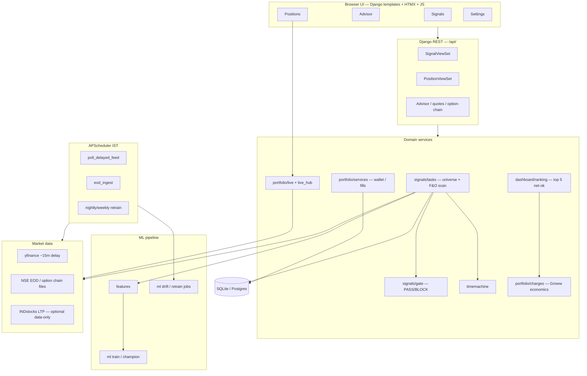
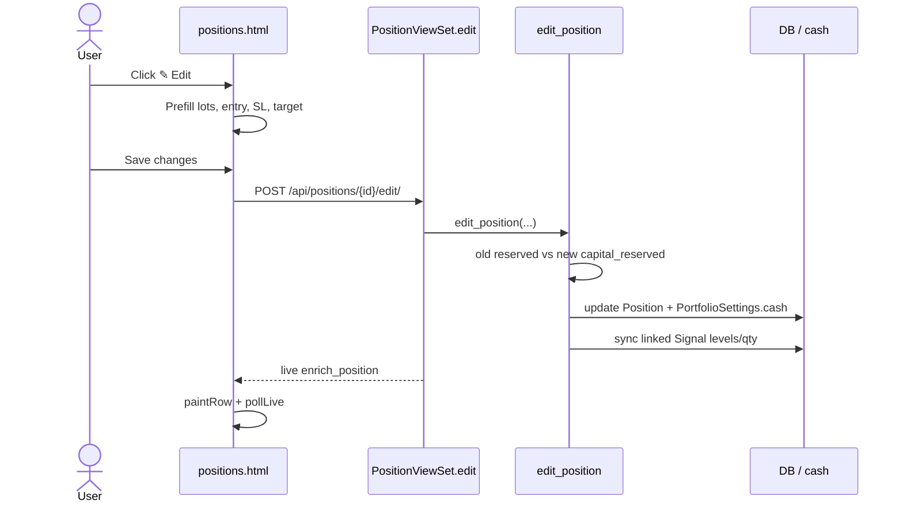

# StockScope India — Full Features, Architecture, HLD & LLD

> Single reference for **what the product does**, **how the system is structured**, **high-level design**, and **low-level design**.  
> Code-aligned to the Django repo (signals-only · ₹2,000 wallet · never places broker orders).

Related: [README.md](README.md) · design notes in [stockscope_india_project.md](stockscope_india_project.md)

---

## 0. One-line product

**StockScope India** is a local Django app that reads NSE market data, scores Normal (CNC equity) and F&O debit option ideas with LightGBM + rules, shows **top wallet-fit suggestions net of Groww charges**, and tracks a **paper/real-life wallet** of ₹2,000 while **you** place every order yourself in Groww / any broker.

---

## 1. Non-negotiable rules

| Rule | Meaning |
|------|---------|
| Signals only | `ALLOW_BROKER_ORDERS = False` — no `/order`, no Groww/INDstocks place APIs |
| ₹2,000 capital | `config/trading_config.py` → `CAPITAL = 2000` |
| Survival floors | ALIVE → SURVIVAL (≤ ₹1,700) → DEAD (≤ ₹800); kill mid-band ~₹1,500 |
| F&O = debit, same-day style | 1+ lots must fit wallet; suggestions filtered by **net** P&L after charges |
| Live marks optional | INDstocks token = LTP / option chain **data only** |
| Default port | `8001` with embedded APScheduler |

---

## 2. Feature catalogue (all product surfaces)

### 2.1 Signals (home `/`)

- Scan Normal CNC universe + F&O underlyings from **Settings watchlist only** (no one-off F&O analyze on the page).
- Rank **top 5 Normal** and **top 5 F&O** by wallet-aware score (`dashboard/ranking.py`).
- Each card: entry / SL / targets, qty or **1 lot × lot_size**, probability, Time Machine summary, PASS/BLOCK gate, Groww net economics tip.
- Collapsed F&O short-hold card → expand → copy levels for Groww.
- Confirm: **Did you place this?** → fill price → opens a `Position` + `OrderFill` BUY leg; or Skip.

### 2.2 Coach (`/advisor/`) — formerly Advisor

Practice-first options: SKIP on kill switch / lockout / DEAD; PRACTICE while `strategy_unlocked("fno")` is false. Shows loss-at-stop ₹ and % of wallet, plus trend-matching CALL/PUT note.

### 2.2b Results (`/results/`)

Tabs: Practice results (shadow unlock), Model health (honest OOS metrics), Backtest, Model votes, Blocked ideas. Legacy `/calls/`, `/models/`, `/backtest/`, `/blocked/` redirect here.

### 2.2c Evidence / shadow book

Every scanned idea is registered as a `ShadowTrade`. Options practice scans at 09:50 / 11:30; marks every 5 minutes; EOD stock resolution via the shared ticket simulator. Unlock when recommended trades clear bootstrap CI above zero.

### 2.2d Advisor (legacy name kept in URLs)

- Guided chat: pick NIFTY / BANKNIFTY → CALL/PUT → auto or live strike.
- Returns **BUY or SKIP** sized to current wallet; shows live premium when data available.
- API: `POST /api/advisor/start/`, `POST /api/advisor/chat/`.

### 2.3 Positions (`/positions/`) — Groww-style book

- Open / Closed / All filters.
- Broker strip: Invested, Current value, Open P&L (gross/net), Equity mark, Cash.
- Row: contract, product, side, **lots label**, avg, LTP, invested, current, P&L, SL/Target, HOLD/TAKE ACTION advice.
- Fills under each row (BUY/SELL + brokerage/STT/exchange/GST/DP).
- Actions: Reanalyze · **Edit** (lots, entry, SL, target) · Delete · Square off (exit LTP + reason).
- **+ Add Groww order**: dummy record (symbol, CE/PE, strike, lots, lot size, entry, stop, target, optional exit).
- Live LTP poll **every 10s only while Positions tab is visible** (`visibilitychange` + `pagehide`); pauses when hidden.
- Hub: `portfolio/live_hub.py` (`LiveMarksHub`, refresh ~10s when work is needed).

### 2.4 Settings (`/settings/`)

- F&O multi-select watchlist (`PortfolioSettings.fno_watchlist`).
- Kill switch, life status, wallet display (via context processor).

### 2.5 Performance / Models / Backtest / Blocked

- Performance: equity, day/week P&L, paper gates.
- Models: champion/candidate LightGBM versions; admin retrain/promote.
- Backtest: engine under `backtest/`.
- Blocked: gate failures list.

### 2.6 Desktop launcher

- `scripts/create_desktop_shortcut.ps1` → starts server + opens Chrome on `http://127.0.0.1:8001`.

---

## 3. Repository map

```
stock-market/
├── config/                 # Django settings, URLs, trading_config (capital/fees/risk)
├── marketdata/             # Instruments, bars, providers, option chain, jobs, scheduler
│   ├── events.py           # NSE announcements / results / event flags
│   └── regime.py           # NIFTY + India VIX → trend/range/high_vol
├── features/               # Indicators, feature builders, labels
├── ml/                     # LightGBM train/evaluate/registry/retrain/drift
│   └── meta_filter.py      # Mistake meta-filter + calibration (candidate promote)
├── signals/                # Order tickets, F&O plans, risk gate, scan tasks
│   ├── pipeline.py         # 9-stage day-trader pipeline → Signal.pipeline
│   ├── news.py / entry_timer.py / exit_planner.py / budget.py / ticket.py
├── portfolio/              # Wallet, positions, fills, Groww charges, live marks
│   ├── management.py       # Live HOLD / MOVE SL / TRAIL / EXIT (SL tighten-only)
│   └── reviews.py          # TradeReview + discipline score
├── dashboard/              # Templates, views, DRF API, advisor, ranking (Today UI)
├── scanner/                # ORB + patterns (flag, oversold bounce)
├── timemachine/            # Monte Carlo / replay before trade
├── backtest/               # Historical engine
├── notifications/          # Telegram (optional)
├── scripts/                # Desktop start / Chrome open
├── tests/                  # pytest (incl. no-broker-order guarantee)
├── artifacts/              # Model joblib bundles (e.g. swing_lgbm)
├── manage.py
├── requirements.txt
└── STOCKSCOPE_FULL_ARCHITECTURE.md   ← this file
```

---

## 4. High-level design (HLD)

### 4.1 Architecture diagram



### 4.2 Runtime topology

| Mode | Command | Behavior |
|------|---------|----------|
| Default local | `python manage.py run --port 8001` | WSGI/dev server + **embedded** BackgroundScheduler |
| Worker-only | `python manage.py run_worker` | BlockingScheduler only |
| Bootstrap | `python manage.py bootstrap --force-train` | migrate, universe, backfill, train + promote |
| Disable jobs | `DISABLE_SCHEDULER=1` | Web without cron jobs |

### 4.3 Data flow — Normal CNC signal

```
Universe symbols
  → MarketDataService bars (yfinance / cache)
  → features + champion LightGBM P(up)
  → signals.engine.build_order (entry/SL/T1/T2, qty, RR)
  → timemachine edge check
  → risk_gate (cash, life, windows, kill switch)
  → Signal row (NEW / may be BLOCK in gate JSON)
  → ranking.score_signal + trade_economics (CNC multi-day OK)
  → top 5 on Signals page
```

### 4.4 Data flow — F&O debit plan

```
PortfolioSettings.fno_watchlist (e.g. NIFTY, BANKNIFTY)
  → signals.fno.build_fno_plan
      · spot + ATR, weekly/monthly expiry
      · option chain (INDstocks or cached NSE JSON under data/option_chain/)
      · pick CE/PE strike where premium × lot_size ≤ wallet
      · live buy_ltp / sl_ltp / target_ltp; net_ok via trade_economics
  → Signal strategy=fno_intraday, qty=lots, reasons.fno = plan
  → ranking top 5 F&O (net_ok filter)
```

### 4.5 Confirm → position → close

```
mark_signal_taken(fill_price)
  → Position OPEN + reserved_cash (lot-aware)
  → OrderFill BUY (charges, net_cash_flow)
  → cash ↓

edit_position(lots, entry, stop, target)
  → adjust reserved_cash vs wallet

close_position(exit, reason)
  → OrderFill SELL + charges
  → pnl net of charges; cash ↑; life_status refresh

delete_position
  → restore reserved cash; no P&L (paper cleanup)
```

### 4.6 Live marks HLD

- **Positions page visible** → JS `pollLive` every 10s → `GET /api/positions/live/?refresh=1`.
- Tab hidden / leave page → stop timer (no background realtime).
- Server hub can also serve SSE `GET /api/positions/stream/` (optional); polling is primary for runserver friendliness.
- Shared option-chain fetch per underlying; fingerprint skip identical frames.

### 4.7 Survival & risk HLD

```
equity > 1700  → ALIVE   (default risk params)
800 < eq ≤ 1700 → SURVIVAL (tighter risk / higher min_prob)
equity ≤ 800   → DEAD    (no new trades until reset_life)
```

Kill switch can arm independently; gate blocks emits when on.

---

## 5. Low-level design (LLD)

### 5.1 Django apps & responsibilities

| App | Responsibility | Key modules |
|-----|----------------|-------------|
| `config` | Settings, URLs, capital/fees/risk constants | `settings.py`, `trading_config.py`, `urls.py` |
| `marketdata` | Instruments, OHLCV bars, providers, chains, cron | `service.py`, `option_chain.py`, `indstocks.py`, `scheduler.py`, `jobs.py` |
| `features` | Technical features & labels for ML | `indicators.py`, `builders.py`, `labels.py` |
| `ml` | Train, evaluate, registry, drift, retrain | `train.py`, `registry.py`, `retrain.py`, `drift.py` |
| `signals` | Tickets, F&O, gate, scan orchestration | `engine.py`, `fno.py`, `gate.py`, `risk.py`, `tasks.py` |
| `portfolio` | Wallet, positions, fills, charges, live | `models.py`, `services.py`, `charges.py`, `live.py`, `live_hub.py` |
| `dashboard` | UI + API + ranking + advisor | `views.py`, `api.py`, `ranking.py`, `advisor.py` |
| `scanner` | ORB plans | `orb.py` |
| `timemachine` | Simulation | `sim.py` |
| `backtest` | Historical runs | `engine.py` |
| `notifications` | Telegram | `telegram.py` |

### 5.2 Domain models (LLD)

#### `marketdata.Instrument`
- `symbol` (e.g. `RELIANCE.NS`), liquidity fields, ASM/GSM flag, `last_price`.

#### `marketdata.Bar`
- Unique `(instrument, interval, ts)`; OHLCV + `source`.

#### `signals.Signal`
- Side, product (`CNC`/`…`), strategy (`swing` / `fno_intraday`).
- Levels: `entry_trigger/limit`, `sl_*`, `target1/2`, `qty`, `capital_used`, `max_loss`, `rr_net`, `probability`.
- `gate` JSON, `time_machine` JSON, `reasons` JSON (holds `fno` plan + economics).
- `pipeline` JSON — 9 stages: scanner, news, entry, exit, time_machine, budget, gate, ticket, alerts.
- `entry_status`: waiting / triggered / expired.
- Status: `new` → `triggered` / `skipped` / …

#### `portfolio.Position`
- Links instrument + optional signal; `qty` = **lots for F&O**, shares for equity.
- `entry_price`, `stop`, `target`, `reserved_cash`, `status` open/closed, `pnl`.
- `planned_entry/stop/target` frozen at confirm; `adjustment_log`; `last_mgmt_action`.

#### `portfolio.TradeReview`
- One-to-one with closed `Position`: `exit_reason`, `mistake_tags`, `note`, `planned_vs_actual`, `followed_plan`, `regime_snapshot`.

#### `portfolio.OrderFill`
- One BUY or SELL leg; `units`, `turnover`, `charges` JSON, `charges_total`, `net_cash_flow`.
- `source`: `signal_confirm` | `close` | `manual_groww`; `mistake_note` for future training.

#### `portfolio.PortfolioSettings` (singleton via `get_solo()`)
- `cash`, `equity`, `start_equity`, `life_status`, `kill_switch`, day/week PnL keys.
- `consecutive_losses`, `lockout_until` (24h after 2 losses).
- `fno_watchlist` JSON list, `fno_auto_analyze`.

#### `portfolio.EquitySnapshot`
- Time series of equity/cash/open_pnl.

#### `ml.ModelVersion` / `DriftReport`
- Champion/candidate/retired; artifact path under `artifacts/`; PSI drift reports.

### 5.3 Core functions (call map)

| Concern | Function | File |
|---------|----------|------|
| Build equity ticket | `build_order` | `signals/engine.py` |
| F&O plan | `build_fno_plan`, `lot_size_for` | `signals/fno.py` |
| Scan equity | `generate_signals_for_universe` | `signals/tasks.py` |
| Scan F&O | `generate_fno_for_underlyings` | `signals/tasks.py` |
| Gate | `risk_gate`, `in_entry_window` | `signals/gate.py` |
| Size / tick | `position_size`, `round_tick` | `signals/risk.py` |
| Rank + score | `score_signal`, `economics_for_signal` | `dashboard/ranking.py` |
| Groww fees | `calc_leg_charges`, `trade_economics` | `portfolio/charges.py` |
| Confirm order | `mark_signal_taken` | `portfolio/services.py` |
| Manual Groww | `add_manual_groww_order` | `portfolio/services.py` |
| Edit lots/SL/tgt | `edit_position` | `portfolio/services.py` |
| Close / delete | `close_position`, `delete_position` | `portfolio/services.py` |
| Live enrich | `enrich_position`, `suggest_action` | `portfolio/live.py` |
| Hub | `LiveMarksHub`, `get_hub` | `portfolio/live_hub.py` |
| Train / promote | `fit_lgbm`, `retrain_and_maybe_promote`, `promote` | `ml/train.py`, `ml/retrain.py`, `ml/registry.py` |
| Life mode | `life_status_for_equity`, `risk_params_for_equity` | `config/trading_config.py` |

### 5.4 HTTP surface

#### Pages (`dashboard/urls.py`)

| Path | View |
|------|------|
| `/` | `signals_page` (Today) |
| `/advisor/` | `advisor_page` |
| `/positions/` | `positions_page` |
| `/journal/` | `journal_page` |
| `/journal/weekly/` | `journal_weekly_page` |
| `/insights/` | `insights_page` (+ Advanced: Models/Backtest/Blocked) |
| `/performance/` | `performance_page` |
| `/models/` | `models_page` |
| `/backtest/` | `backtest_page` |
| `/settings/` | `settings_page` |
| `/blocked/` | `blocked_page` |
| `/partials/signals/` | HTMX partial |

#### API (`dashboard/api_urls.py` + `api.py`)

| Method | Path | Purpose |
|--------|------|---------|
| GET/POST | `/api/signals/`, `/api/signals/scan/` | List / scan |
| POST | `/api/signals/{id}/mark-taken/` | Confirm fill |
| POST | `/api/signals/{id}/skip/` | Skip |
| GET | `/api/signals/{id}/timemachine/`, `/gate/` | Debug TM/gate |
| GET | `/api/positions/`, `/api/positions/live/` | Book + live snapshot |
| POST | `/api/positions/{id}/close/` | Square off |
| POST | `/api/positions/{id}/delete/` | Delete + restore cash |
| POST | `/api/positions/{id}/edit/` | Lots / entry / SL / target |
| POST | `/api/positions/{id}/reanalyze/` | Fresh mark + F&O plan |
| POST | `/api/positions/manual-groww/` | Add dummy Groww order |
| GET | `/api/positions/charges-preview/` | Preview fees |
| GET | `/api/positions/stream/` | SSE marks (optional) |
| GET | `/api/quotes/{symbol}/`, `/api/option-chain/` | Market data |
| POST | `/api/advisor/start/`, `/chat/` | Advisor |
| GET | `/api/performance/`, `/analysis/`, `/health/` | Ops |
| POST | `/api/kill-switch/`, `/portfolio/reset-life/` | Safety |
| GET/POST | `/api/settings/fno-watchlist/` | Watchlist |
| POST | `/api/models/retrain/`, `/{id}/promote/` | Admin ML |

### 5.5 Scheduler jobs (IST)

| Job | Cron (approx) | Module |
|-----|---------------|--------|
| `refresh_master` | Mon–Fri 08:30 | universe |
| `premarket_plan` | 08:45 | plans |
| `poll_delayed_feed` | 09–15 every 5m | bars |
| `orb_plans` | 09:46 | ORB if enabled |
| `cancel_orb_reminder` | 14:00 | reminder |
| `square_off_reminder` | 15:10 | reminder |
| `eod_ingest` | 16:00 | EOD bars |
| `nightly_retrain` | 16:30 | incremental ML |
| `weekly_retrain` | Sat 10:00 | full Optuna |
| `drift_check` | :05 every hour | PSI |

### 5.6 Groww charges LLD (summary)

`portfolio/charges.py` models per-leg:

- Brokerage ≈ ₹20/order (options) or min(₹20, 0.1%) equity.
- STT, exchange, SEBI, stamp, GST; CNC sell may include DP.
- `trade_economics(buy, sell, units, product, is_option)` → gross, charges_total, **net_pnl**, `net_ok`, breakeven tip.
- Ranking **drops** ideas with `net_ok=False` (charges eat the edge).

### 5.7 F&O lot & cash LLD

- `Position.qty` = number of lots.
- Units traded = `lots × lot_size` (`portfolio/live.qty_units`).
- Reserved cash at open ≈ premium × units (+ buy charges via fill).
- Edit lots/entry recalculates `reserved_cash` and adjusts `PortfolioSettings.cash` by delta.

### 5.8 Positions UI LLD (JS)

- Boot snapshot via `json_script` → immediate paint.
- Event delegation on `[data-act]` (close/edit/delete/reanalyze).
- Edit form `#edit-form`: lots, entry, stop, target → `POST .../edit/`.
- Add form `#manual-form`: same fields + symbol/strike → `POST .../manual-groww/`.
- `LIVE_MS = 10000`; `visibilitychange` → `stopLive` / `startLive`.

### 5.9 ML LLD (sketch)

```
Bars → features.builders + labels
  → time_train_test_split / walk_forward_train
  → fit_lgbm (+ optional optuna_search)
  → registry.save → artifacts/swing_lgbm/vN.joblib
  → promote → status=champion
  → predict_proba at scan time
  → drift PSI → DriftReport → maybe retrain
```

### 5.10 Config knobs (`trading_config.py`)

| Constant | Typical | Role |
|----------|---------|------|
| `CAPITAL` | 2000 | Wallet start |
| `DEAD_FLOOR` / `SURVIVAL_EQUITY` | 800 / 1700 | Life bands |
| `RISK_PER_TRADE` | 1.5% | Max loss sizing |
| `MAX_OPEN_POSITIONS` | 1 | Concurrency |
| `MIN_RR` | 1.5 net | Edge after fees |
| `MAX_DATA_AGE_SEC` | 1200 | Stale data gate |
| `ALLOW_BROKER_ORDERS` | False | Hard lock |
| `FEES` | `FeeSchedule` | Legacy estimate (Groww detail in `charges.py`) |

### 5.11 Environment (`.env`)

| Variable | Use |
|----------|-----|
| `DJANGO_SECRET_KEY`, `DJANGO_DEBUG` | Django |
| `DATABASE_URL` | sqlite default / Postgres prod |
| `DATA_PROVIDERS` | e.g. `yfinance,nse_eod` |
| `INDSTOCKS_ACCESS_TOKEN` | Live LTP/chain only |
| `TELEGRAM_*` | Optional alerts |
| `PORT` | Default 8001 |
| `RUN_EMBEDDED_SCHEDULER` | One-process jobs |
| `DISABLE_SCHEDULER` | Web without cron |

---

## 6. Sequence — edit lots / SL / target



---

## 7. Security & compliance notes

- No broker credentials required for core path; optional INDstocks token is **read-only** by policy.
- Paper-first: `FORCE_PAPER_UNTIL_GATES` + `paper_gates_passed()`.
- Personal decision-support tool — not multi-user advisory distribution.
- Free data ≈ 15 min delayed unless INDstocks/live feed is configured.

---

## 8. Tests (entry points)

Under `tests/`: API, features, freshness, gate, ORB, order confirm, portfolio, registry, risk, survival, timemachine,
**no-broker-orders**, lockout/revenge, management SL-never-widen, review-required-on-close, meta retrain min-N, charges net filter.

```bash
pytest
```

Hard rule: `tests/test_no_broker_orders.py` fails if `ALLOW_BROKER_ORDERS=True`, place-order URL routes, or real broker HTTP place code appears.

---

## 9. Quick start (ops)

```bash
python -m pip install -r requirements.txt
copy .env.example .env
python manage.py bootstrap --force-train
python manage.py run --port 8001
```

Desktop: `powershell -ExecutionPolicy Bypass -File scripts\create_desktop_shortcut.ps1`

---

## 10. Document index

| Need | Section |
|------|---------|
| What can users do? | §2 Features |
| System boxes & flows | §4 HLD |
| Models, APIs, functions, jobs | §5 LLD |
| Cash / charges / lots | §5.6–5.7 |
| Live poll rules | §2.3 + §4.6 |
| Config / env | §5.10–5.11 |

---

*Generated from the StockScope India codebase. Update this file when you add major surfaces (new apps, broker execution, or model families).*
